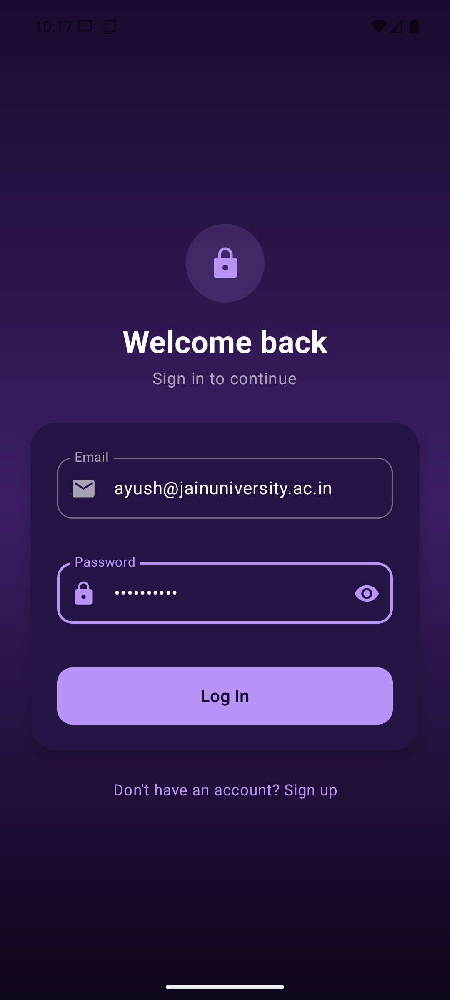
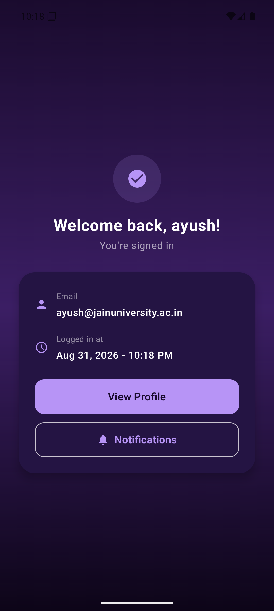
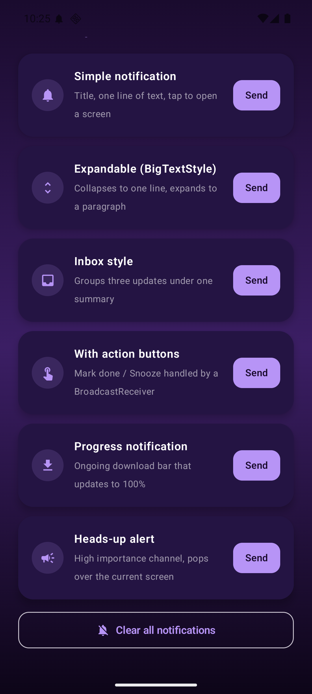
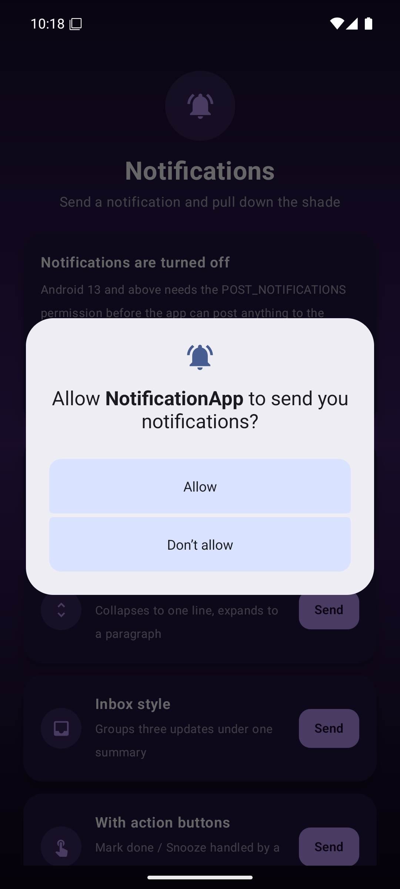
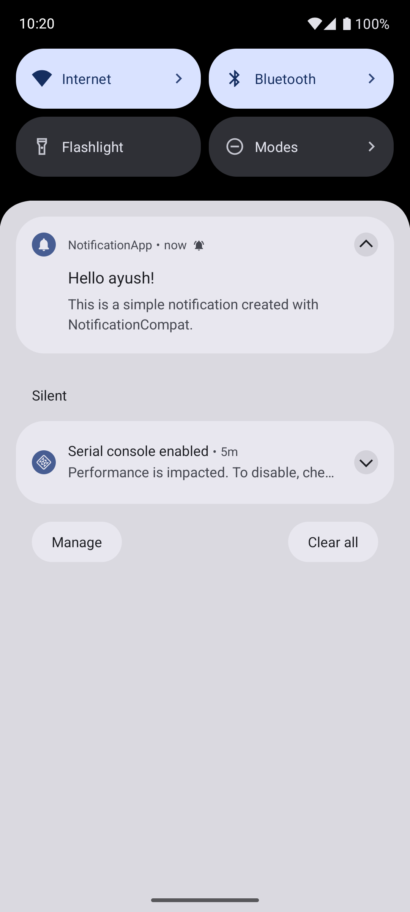
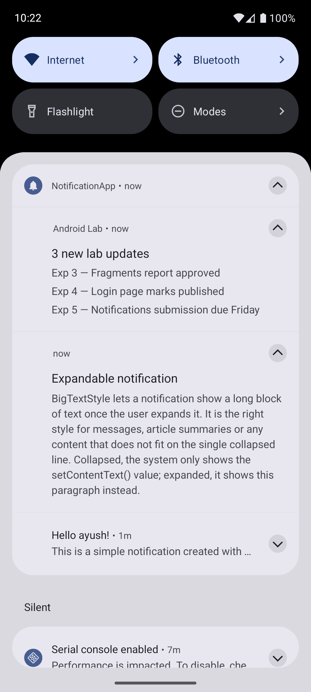
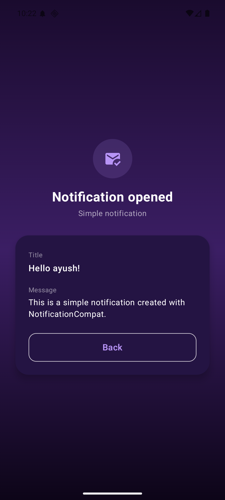
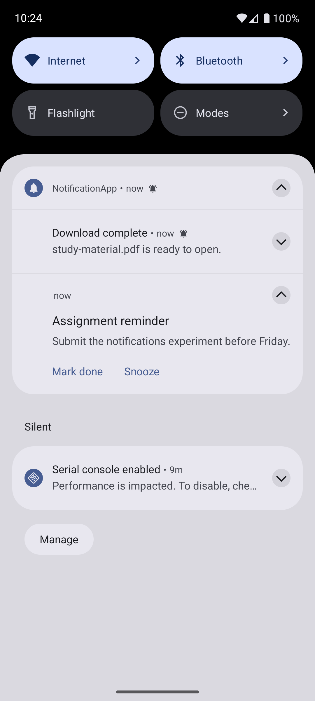
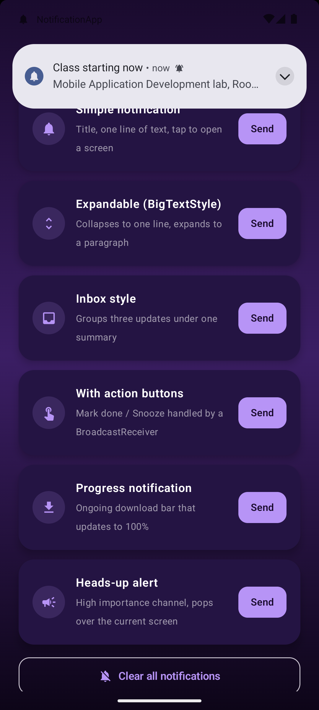

# Experiment 05 - Android Notifications

## Student Details

**Name:** Ayush Kumar

**USN:** 25MCAR0224

---

# Experiment Title

Create an Android application to display Notifications.

---

# Aim

To develop an Android application that creates and displays notifications of different
styles using `NotificationCompat`, handles notification channels, requests the runtime
`POST_NOTIFICATIONS` permission, responds to notification taps and notification action
buttons. The application is built on top of the Experiment 04 Login project, so the
notification screen is reached after a successful login.

---

# Concept / Technology Used

## Notification

A Notification is a message that Android displays outside the app's UI, in the status bar
and the notification shade. It is built with `NotificationCompat.Builder` and posted with
`NotificationManagerCompat.notify()`.

Every notification in this experiment sets:

- A small status-bar icon (`setSmallIcon`)
- A title and text (`setContentTitle`, `setContentText`)
- A channel id (mandatory from Android 8.0)
- A content `PendingIntent` so tapping it opens the app

---

## Notification Channel

From Android 8.0 (API 26) every notification must belong to a channel. The channel decides
the importance, sound and vibration behaviour, and the user can control it from system
settings.

Two channels are created in `NotificationHelper.createChannels()`:

| Channel id | Name | Importance | Used for |
|---|---|---|---|
| `general_updates` | General updates | `IMPORTANCE_DEFAULT` | Simple, big text, inbox, actions, progress |
| `important_alerts` | Important alerts | `IMPORTANCE_HIGH` | Heads-up alert |

---

## POST_NOTIFICATIONS Permission

From Android 13 (API 33) the app must ask the user at runtime before it can post anything.
The app declares the permission in the manifest and requests it with
`ActivityResultContracts.RequestPermission()`. On older versions the permission is granted
implicitly, so the app instead opens app settings if notifications were switched off.

---

## PendingIntent

A `PendingIntent` lets the system fire an intent on the app's behalf, later and from
outside the app.

- `PendingIntent.getActivity` — used for the notification body, opens `NotificationDetailActivity`
- `PendingIntent.getBroadcast` — used for the action buttons, delivered to `NotificationActionReceiver`

Both use `FLAG_IMMUTABLE`, which is required from Android 12 onwards.

---

## Notification Styles Demonstrated

| # | Style | API used |
|---|---|---|
| 1 | Simple notification | title + `setContentText` |
| 2 | Expandable notification | `NotificationCompat.BigTextStyle` |
| 3 | Grouped update list | `NotificationCompat.InboxStyle` |
| 4 | Action buttons | `addAction` + `BroadcastReceiver` |
| 5 | Progress notification | `setProgress` + `setOngoing` |
| 6 | Heads-up alert | high importance channel + `PRIORITY_HIGH` |

---

# Demonstration Scenario

1. The app opens on the **Login** screen from Experiment 04.
2. After logging in, the **Home** screen shows the email and login time, and offers a
   **Notifications** button.
3. The **Notifications** screen lists the six notification types, each with a **Send** button.
4. If the permission was never granted, a card appears asking to allow notifications, and
   the first **Send** triggers the system permission dialog.
5. Sending a notification posts it to the shade. Tapping it opens the **Notification detail**
   screen, which displays the title, message and style the notification was built with.
6. The action buttons (*Mark done* / *Snooze*) show a toast and dismiss the notification
   without opening the app.
7. **Clear all notifications** cancels everything the app has posted.

---

# Project Structure

```
Exp 5
│
├── app
│   ├── src
│   │   └── main
│   │       ├── AndroidManifest.xml        (POST_NOTIFICATIONS, receiver, activities)
│   │       │
│   │       ├── java
│   │       │   └── com.example.notificationapp
│   │       │       ├── LoginActivity.kt              (from Exp 04)
│   │       │       ├── HomeActivity.kt               (from Exp 04 + Notifications button)
│   │       │       ├── ProfileActivity.kt            (from Exp 04)
│   │       │       ├── NotificationsActivity.kt      (the six demos + permission)
│   │       │       ├── NotificationDetailActivity.kt (opened on notification tap)
│   │       │       ├── NotificationHelper.kt         (channels + builders)
│   │       │       ├── NotificationActionReceiver.kt (action buttons)
│   │       │       └── IntentKeys.kt
│   │       │
│   │       └── res
│   │           └── drawable
│   │               └── ic_notification.xml           (status bar icon)
│
├── Screenshots
└── readme.md
```

---

# Output

The application was run on a Pixel 6 emulator (Android 16, API 36).

Login screen (from Experiment 04) and the Home screen with the new **Notifications** button:

<p align="center">
  
  
</p>

The Notifications screen, listing every notification type that can be sent:

<p align="center">
  
</p>

---

# Test Cases

## Test Case 1

### Objective

Verify that the runtime notification permission is requested on Android 13+.

### Input

Open the Notifications screen and press **Allow notifications** (or **Send** on any card)
while the permission is denied.

### Expected Output

The system permission dialog appears and no notification is posted until it is allowed.

### Actual Output

Working Successfully.

Screenshot:

<p align="center">
  
</p>

---

## Test Case 2

### Objective

Verify that a simple notification is displayed in the notification shade.

### Input

Press **Send** on *Simple notification* and pull down the shade.

### Expected Output

A notification with the title "Hello ayush!" and one line of text is shown.

### Actual Output

Working Successfully.

Screenshot:

<p align="center">
  
</p>

---

## Test Case 3

### Objective

Verify that `BigTextStyle` and `InboxStyle` notifications expand.

### Input

Send *Expandable (BigTextStyle)* and *Inbox style*, then expand them in the shade.

### Expected Output

The big text notification expands into a full paragraph and the inbox notification shows
its three update lines under one summary.

### Actual Output

Working Successfully.

Screenshot:

<p align="center">
  
</p>

---

## Test Case 4

### Objective

Verify that tapping a notification opens the app and carries its data across.

### Input

Send *Simple notification* and tap its body in the shade.

### Expected Output

The Notification detail screen opens and shows the same title, message and style. The
notification is removed from the shade because of `setAutoCancel(true)`.

### Actual Output

Working Successfully.

Screenshot:

<p align="center">
  
</p>

---

## Test Case 5

### Objective

Verify the action buttons and the progress notification.

### Input

Send *With action buttons* and *Progress notification*, then press **Mark done**.

### Expected Output

The reminder notification shows the *Mark done* and *Snooze* buttons; pressing one runs the
`BroadcastReceiver`, shows a toast and dismisses the notification without opening the app.
The progress notification advances to 100% and is then replaced by "Download complete".

### Actual Output

Working Successfully. The reminder disappeared from the shade as soon as **Mark done** was
pressed, confirming the receiver ran.

Screenshot:

<p align="center">
  
</p>

---

## Test Case 6

### Objective

Verify that a high importance channel produces a heads-up notification.

### Input

Send *Heads-up alert* while the app is on screen.

### Expected Output

The notification pops over the current screen instead of only entering the shade.

### Actual Output

Working Successfully.

Screenshot:

<p align="center">
  
</p>

---

# Result

The Android application was successfully developed to create and display notifications.
Notification channels, the runtime `POST_NOTIFICATIONS` permission, six notification styles,
notification tap handling through a `PendingIntent` and notification action buttons handled
by a `BroadcastReceiver` were all demonstrated successfully on a Pixel 6 emulator running
Android 16 (API 36).
