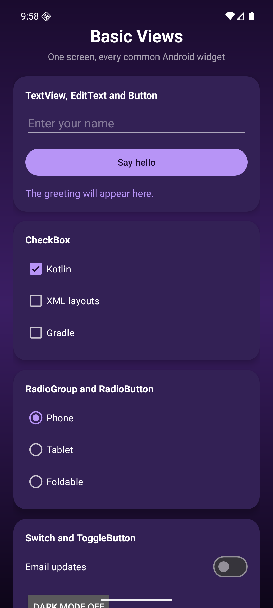
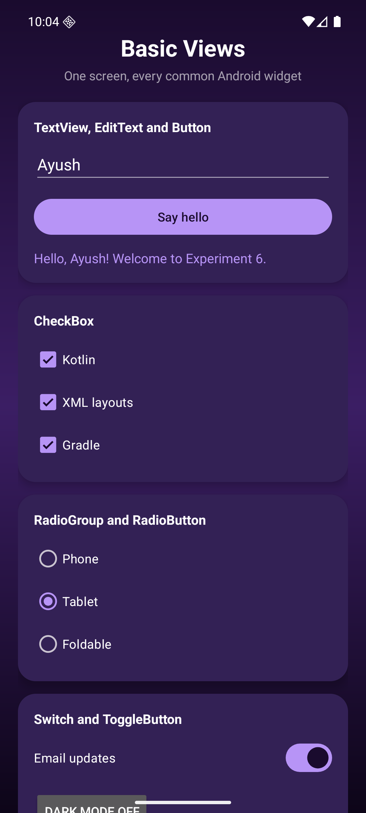
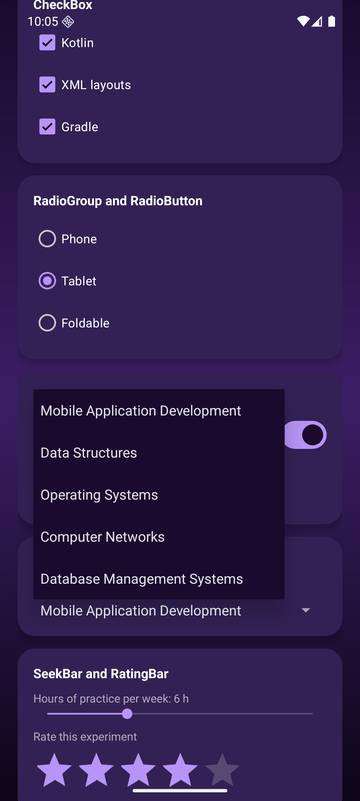
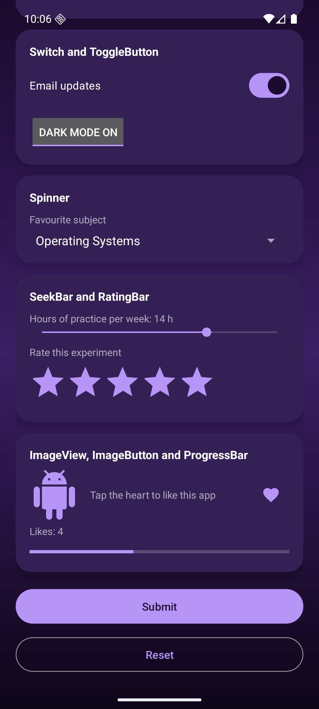
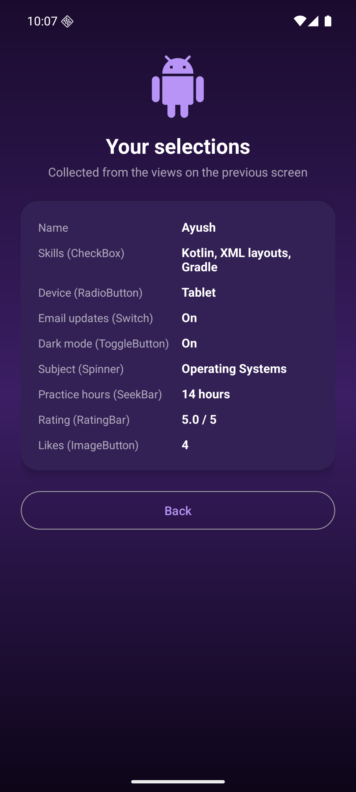
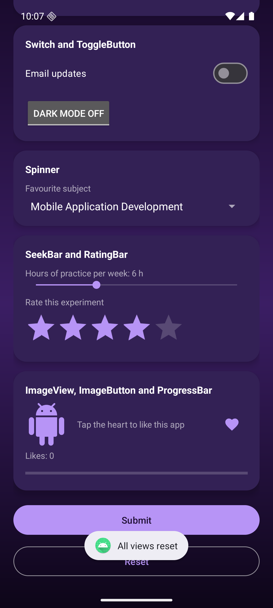

# Experiment 06 - Android Basic Views

## Student Details

**Name:** Ayush Kumar

**USN:** 25MCAR0224

---

# Experiment Title

Develop an Android application using basic Views.

---

# Aim

To develop an Android application that demonstrates the basic Views (widgets) provided by the
Android framework — TextView, EditText, Button, CheckBox, RadioGroup with RadioButton, Switch,
ToggleButton, Spinner, SeekBar, RatingBar, ImageView, ImageButton and ProgressBar — declared in
an XML layout, accessed from Kotlin, and wired up with event listeners. The values held by all
the views are then collected and displayed on a second screen.

---

# Concept / Technology Used

## View and ViewGroup

A **View** is the basic building block of the Android user interface — it occupies a rectangular
area on screen and is responsible for drawing itself and handling events. A **ViewGroup** is an
invisible container that holds other views and decides how they are positioned.

In this experiment:

- `ScrollView` + `LinearLayout` arrange the screen so that all sections can be scrolled.
- `MaterialCardView` groups each family of widgets into its own card.
- `TableLayout` with `TableRow` lays out the label/value pairs on the summary screen.

---

## Basic Views demonstrated

| View | Purpose in this app | Listener / API used |
|---|---|---|
| `TextView` | Titles, section headings and the greeting output | `setText()` |
| `EditText` | Reads the user's name | `text.toString()` |
| `Button` | *Say hello*, *Submit*, *Reset* | `setOnClickListener` |
| `CheckBox` | Three independent skill options | `isChecked` |
| `RadioGroup` + `RadioButton` | Mutually exclusive device choice | `checkedRadioButtonId` |
| `Switch` (`MaterialSwitch`) | Email updates on/off | `isChecked` |
| `ToggleButton` | Dark mode ON/OFF with two captions | `textOn` / `textOff`, `isChecked` |
| `Spinner` | Drop-down list of subjects | `android:entries`, `selectedItem` |
| `SeekBar` | Practice hours from 0 to 20 | `OnSeekBarChangeListener` |
| `RatingBar` | Five-star rating | `rating` |
| `ImageView` | Displays a vector drawable | `android:src` |
| `ImageButton` | Clickable heart that counts likes | `setOnClickListener` |
| `ProgressBar` | Horizontal bar driven by the like count | `progress`, `max` |

---

## View Binding

Instead of calling `findViewById()` for every widget, the project enables **View Binding**:

```kotlin
binding = ActivityMainBinding.inflate(layoutInflater)
setContentView(binding.root)
binding.greetButton.setOnClickListener { /* ... */ }
```

Gradle generates the `ActivityMainBinding` class from `activity_main.xml`, so every view with an
`android:id` is available as a type-safe property.

---

## Passing view values between activities

When **Submit** is pressed, `MainActivity` reads the state of every view, puts the values into an
`Intent` as extras and starts `SummaryActivity`, which displays them. This shows how the data
held by views is read in Kotlin rather than just rendered on screen.

---

# Demonstration Scenario

1. The app opens with every widget in its default state.
2. The user types a name and presses **Say hello** — a `TextView` shows the greeting.
3. The user ticks the CheckBoxes, picks a RadioButton, flips the Switch and the ToggleButton.
4. The Spinner is opened and a different subject is selected.
5. The SeekBar is dragged (its label updates live) and a five-star rating is given.
6. The heart ImageButton is tapped a few times — the like counter and the ProgressBar advance.
7. **Submit** opens the summary screen listing the value of every view.
8. **Reset** returns every view to its initial state and shows a Toast.

---

# Project Structure

```
Exp 6
│
├── app
│   ├── src
│   │   └── main
│   │       ├── AndroidManifest.xml
│   │       │
│   │       ├── java
│   │       │   └── com.example.basicviews
│   │       │       ├── MainActivity.kt          (all the view listeners)
│   │       │       ├── SummaryActivity.kt       (shows the collected values)
│   │       │       └── Extras.kt                (intent extra keys)
│   │       │
│   │       └── res
│   │           ├── layout
│   │           │   ├── activity_main.xml        (every basic View)
│   │           │   └── activity_summary.xml     (TableLayout of results)
│   │           │
│   │           ├── drawable
│   │           │   ├── bg_gradient.xml
│   │           │   ├── ic_android_banner.xml
│   │           │   └── ic_favorite.xml
│   │           │
│   │           └── values
│   │               ├── colors.xml
│   │               ├── strings.xml              (includes the Spinner string-array)
│   │               └── themes.xml
│
├── Screenshots
└── readme.md
```

---

# Output

The application was run on a Pixel 6 emulator (Android 16, API 36).

Every widget in its default state when the app opens:

<p align="center">
  
</p>

---

# Test Cases

## Test Case 1

### Objective

Verify that the Button reads the EditText and writes the result into a TextView, and that the
CheckBox, RadioButton and Switch respond to taps.

### Input

Type `Ayush`, press **Say hello**, tick all three CheckBoxes, select **Tablet**, turn the
Switch on.

### Expected Output

The TextView shows "Hello, Ayush! Welcome to Experiment 6.", the three CheckBoxes are ticked,
only **Tablet** is selected in the RadioGroup, and the Switch is on.

### Actual Output

Working Successfully.

Screenshot:

<p align="center">
  
</p>

---

## Test Case 2

### Objective

Verify that the Spinner shows its list of items and keeps the chosen one.

### Input

Tap the Spinner and choose **Operating Systems**.

### Expected Output

The drop-down lists all five subjects from the `string-array` and the Spinner then displays the
selected item.

### Actual Output

Working Successfully.

Screenshot:

<p align="center">
  
</p>

---

## Test Case 3

### Objective

Verify the SeekBar, RatingBar, ImageButton and ProgressBar.

### Input

Drag the SeekBar to the right, tap the fifth star, tap the heart four times.

### Expected Output

The SeekBar label updates live to "Hours of practice per week: 14 h", the RatingBar shows 5
stars, the like counter reads "Likes: 4" and the ProgressBar fills to 4 out of 10.

### Actual Output

Working Successfully.

Screenshot:

<p align="center">
  
</p>

---

## Test Case 4

### Objective

Verify that the values held by all the views are read correctly and passed to the second screen.

### Input

Press **Submit**.

### Expected Output

The summary screen lists the name, checked skills, selected device, Switch and ToggleButton
states, Spinner selection, SeekBar value, rating and like count.

### Actual Output

Working Successfully. Every value matches what was set on the previous screen.

Screenshot:

<p align="center">
  
</p>

---

## Test Case 5

### Objective

Verify that Reset restores every view to its initial state.

### Input

Return to the first screen and press **Reset**.

### Expected Output

The EditText is cleared, the greeting goes back to its placeholder, only *Kotlin* stays checked,
**Phone** is selected again, the Switch and ToggleButton turn off, the Spinner returns to the
first subject, the SeekBar returns to 6 h, the rating returns to 4 stars, the like count and the
ProgressBar return to 0, and a Toast confirms the reset.

### Actual Output

Working Successfully.

Screenshot:

<p align="center">
  
</p>

---

# Result

The Android application was successfully developed using basic Views. TextView, EditText,
Button, CheckBox, RadioGroup with RadioButton, Switch, ToggleButton, Spinner, SeekBar,
RatingBar, ImageView, ImageButton and ProgressBar were all declared in XML, accessed from Kotlin
through View Binding, and wired up with their event listeners. The values held by the views were
collected into an Intent and displayed on a second activity, and all cases were verified on a
Pixel 6 emulator running Android 16 (API 36).
